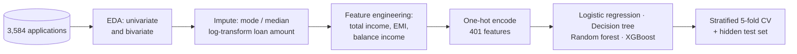
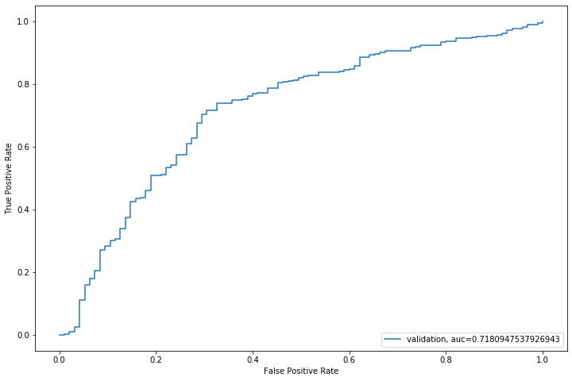
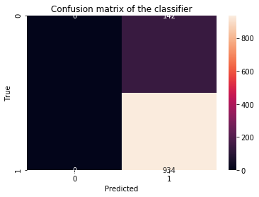

# Loan Approval Prediction

Predicts whether a commercial bank will approve a loan application, compares four classifiers, and includes an **assurance review** of what the accuracy numbers really mean.

| | |
|---|---|
| **Category** | Data Science · Machine Learning (classification) |
| **Stack** | Python 3 · pandas · NumPy · scikit-learn · XGBoost · matplotlib · seaborn |
| **Data** | 3,584 labelled and 4,210 unlabelled loan applications from a Zimbabwean commercial bank (not published) |
| **Status** | Completed as an MSc Data Analytics assignment. Assurance review added 2026-11 |

## Why this project
Loan officers decide on thousands of applications by hand. A model that predicts approval from the application form can speed up the easy cases and flag the risky ones for a closer look. The business question: **which applicant characteristics predict approval, and how well can a model predict it?**

## Approach


- **Features:** gender, marital status, dependants, profession, property location, gross income, guarantee income and amount, facility limit (loan amount), contract type, number of instalments and credit history.
- **Hypotheses** tested in the bivariate analysis: higher income, smaller loans, shorter terms and a good credit history should raise the chance of approval. Income alone turned out not to matter; low *total* income and large loans did.
- **Cleaning:** mode imputation for categorical gaps, median for loan amount (it has outliers), log transform to reduce skew.
- **Models:** logistic regression, decision tree, random forest and XGBoost (tuned with grid search: `max_depth=1`, `n_estimators=81`), each with stratified 5-fold cross-validation, then scored on a hidden test set.

## Results

| Model | Mean CV accuracy | Hidden test accuracy |
|---|---|---|
| Logistic regression | 0.867 | **0.785** |
| Random forest | 0.867 | 0.778 |
| XGBoost (tuned) | 0.867 | 0.778 |
| Decision tree | 0.798 | 0.646 |

Logistic regression had a validation **ROC AUC of 0.72**.



### Assurance review: the model only matches the baseline
Read on its own, 87% accuracy and 100% recall look strong. The confusion matrix tells a different story:



- **86.7% of applications in the data were approved** (3,109 of 3,584). A "model" that approves everyone scores 0.867, exactly the cross-validated accuracy of three of the four models.
- On the validation set, logistic regression predicted **approve for all 1,076 applications**. Recall on rejections is **0.00**, so it never flags a loan that should be declined. That is the case a bank cares about most.
- The original notebook stated there was *no* class imbalance; that was the root cause. Accuracy is the wrong metric at an 87/13 split.
- The AUC of 0.72 shows the model *does* rank applicants better than chance, so there is signal: it is the 0.5 decision threshold that turns it into an always-approve rule.
- Two features are perfectly correlated (r = 1.0, as the notebook found), so one of them adds nothing and should be dropped.

## What's in this folder
```
01-loan-approval-prediction/
├── notebooks/loan-approval-prediction.ipynb   EDA, cleaning, 4 models, evaluation
└── assets/                                     ROC curve and confusion matrix
```

## How to run it
The notebook runs top to bottom in Jupyter with Python 3, pandas, scikit-learn, xgboost, matplotlib and seaborn. It reads `LoansData_Train.csv` and `LoansData_Test2.csv`, which are **not included** (see below). To reuse it, point those two `read_csv` calls at a dataset with the same columns.

## Data, privacy & limitations
- **The data is confidential bank data and is not published.** The bank is not named, and the loan account codes that appeared in notebook outputs have been replaced with `LN-00001`-style placeholders.
- **The models don't beat the baseline** at the default threshold (see the review above). Treat the accuracy figures as a description of the data, not of predictive skill.
- One bank, one period: the model says nothing about other lenders or later lending policy.
- Fairness was not assessed. Gender and marital status are model inputs, which a production credit model would need to justify or remove.

## Next steps
1. Report **balanced accuracy, recall on rejections and PR-AUC** next to accuracy.
2. Use `class_weight="balanced"` (or SMOTE) and **tune the threshold** on the ROC curve for the bank's cost of a bad loan versus a lost good one.
3. Drop one of the two perfectly correlated features, then compare models again.
4. Check performance per gender and marital status before any real use.

---
Part of [Data Science Projects](../../README.md) by **Trevor Kauyu**.
