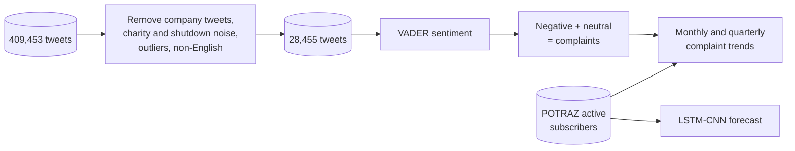
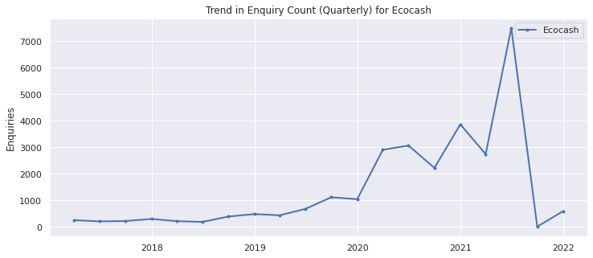
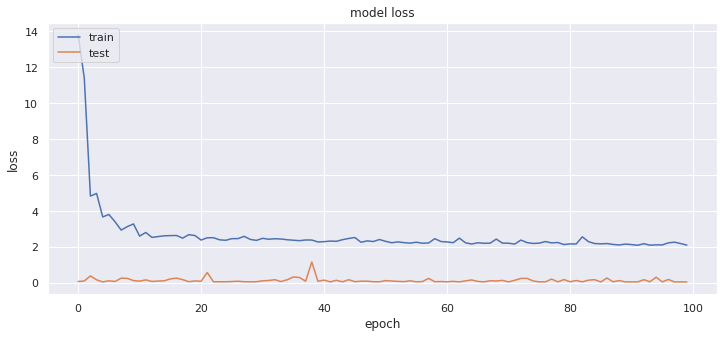

# Mobile Money Sentiment & Market Share (EcoCash)

MSc dissertation: what do customers complain about on Twitter, how did complaints change from 2017 to 2021, and how do they line up with EcoCash's share of active mobile money subscribers?

| | |
|---|---|
| **Category** | Data Science · NLP (sentiment analysis) · Time-series forecasting |
| **Stack** | Python 3 (Google Colab) · pandas · NLTK VADER · WordCloud · TensorFlow/Keras (Conv1D + LSTM) · matplotlib · seaborn |
| **Data** | 409,453 tweets mentioning EcoCash and Econet, January 2017 to October 2021 · quarterly active mobile money subscribers from POTRAZ, Zimbabwe's telecoms regulator |
| **Status** | Completed 2021–22. Dissertation for the MSc in Data Analytics, Chinhoyi University of Technology Graduate Business School |

## Why this project
EcoCash is Zimbabwe's largest mobile money operator. Customers use Twitter to complain about failed transactions, network problems and charges, and a rising complaint volume can signal that customers are about to switch to a competitor (OneMoney, Telecash). The study set out to:

1. Build a time series of customer complaints over the period.
2. Show the monthly distribution of complaints.
3. Compare complaint trends with the operator's actual subscriber numbers.
4. Forecast the subscriber trend.

## Approach


**Data cleaning** was most of the work, and every rule is in the notebook:
- removed **145,290 tweets posted by the companies' own accounts** (EcoCash, Econet, Cassava, OneMoney, NetOne, Telecel), which are not customer complaints;
- removed philanthropy and disaster-relief tweets (Cyclone Idai, scholarships), internet-shutdown campaign hashtags, and incomplete retweets with extreme like or retweet counts;
- tagged each tweet with the operators it mentions, to catch threats to switch provider;
- dropped **348 non-English tweets** (Shona and Ndebele), because VADER is an English lexicon.

**Sentiment:** NLTK VADER scored the 28,455 remaining tweets as **14,342 positive, 7,754 negative and 6,359 neutral**. Negative and neutral tweets were kept as complaints and enquiries.

**Forecast:** a hybrid **LSTM-CNN** (Conv1D → max pooling → LSTM(100) → dense layers) learns from the log of EcoCash's daily active-subscriber series, with a 120-day look-back, and forecasts 120 days ahead from January 2021.

## Results
- **Complaint volume** was flat from 2017 to early 2019, rose steadily through 2019 and jumped in 2020–21, peaking at about 7,500 enquiries in a single quarter of 2021.

  

- **What customers complained about:** of the complaint terms investigated, "Econet" (the network) accounted for **49%** and "EcoCash" for **37%**. Most complaints point to the network and transaction failures rather than the wallet itself.
- **Subscribers kept growing** while complaints rose from 2016 to the end of 2019. The forecast continues that rise, which the dissertation reads as a growing market share for the operator.

  

## What's in this folder
```
02-mobile-money-sentiment-analysis/
├── notebooks/
│   ├── 01-econet-complaints-exploratory-analysis.ipynb      first pass: complaint time series by network operator
│   └── 02-ecocash-sentiment-and-market-share-forecast.ipynb cleaning, VADER, trends, LSTM-CNN
├── data/active-mobile-money-subscribers.csv  POTRAZ quarterly active subscribers: EcoCash, Telecash, OneMoney
├── report/market-share-prediction-dissertation.pdf          the full dissertation (89 pages)
└── assets/                                                   charts used above
```

## How to run it
The notebooks were written for **Google Colab** and read the tweet CSVs from Google Drive (`/content/drive/My Drive/…`). Install `nltk`, `wordcloud`, `tensorflow`, `pandas`, `seaborn`, run `nltk.download('vader_lexicon')`, and point the `read_csv` calls at your own tweet export with `date`, `tweet`, `likes_count`, `retweets_count` and `replies_count` columns.

## Data, privacy & limitations
- **The raw tweets are not published:** they contain personal data, and Twitter's terms limit redistribution. In the notebook outputs, **personal Twitter handles are replaced with `@user`** and phone numbers are masked; company handles are kept.
- **The forecast is univariate:** sentiment is *not* an input to the LSTM-CNN. The link between complaints and market share comes from comparing the two trends, not from the model.
- **The subscriber series is quarterly** (POTRAZ). Spread across days, it becomes a smooth curve, which is why the validation loss is so low. The notebook reports no error metric (RMSE or MAPE) against a naive forecast, so forecast accuracy is not established.
- **VADER** misses sarcasm and local languages, and non-English tweets were dropped. The dissertation recommends sentiment models for Shona and Ndebele.
- **The last quarter in the trend chart is partial:** collection stopped in October 2021, so the drop at the end is a data cut-off, not a fall in complaints.

## Next steps
1. Add complaint volume and sentiment as **inputs** to the forecast, and compare with a naive and a seasonal baseline using MAPE.
2. Label a sample of tweets by hand to measure VADER's accuracy on Zimbabwean English.
3. Try a multilingual model (for example XLM-R) to keep the Shona and Ndebele tweets.

---
Part of [Data Science Projects](../../README.md) by **Trevor Kauyu**.
