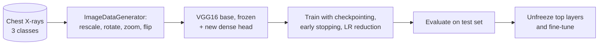
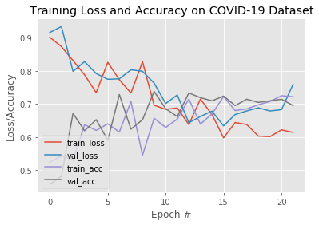

# COVID-19 Chest X-Ray Classification

Transfer learning with **VGG16** to classify chest X-rays into three classes: COVID-19, pneumonia, and no COVID-19 (normal).

| | |
|---|---|
| **Category** | Data Science · Computer Vision · Deep Learning |
| **Stack** | Python 3 · TensorFlow / Keras · VGG16 (ImageNet weights) · OpenCV · scikit-learn · matplotlib |
| **Data** | Public chest X-ray images: COVID-19 cases from published papers and Radiopaedia, plus pneumonia and normal X-rays |
| **Status** | Completed as MSc Data Analytics coursework |

## Why this project
Early in the pandemic, PCR tests were slow and scarce, and many studies asked whether a chest X-ray could help triage patients. This project tests that idea at small scale: **can a pretrained image model, fine-tuned on a few hundred X-rays, tell COVID-19 apart from pneumonia and normal lungs?**

## Approach


- **Augmentation** with Keras `ImageDataGenerator` (rescaling, rotation, zoom, flips) to stretch a small dataset.
- **Transfer learning:** the VGG16 convolutional base with ImageNet weights, frozen, and a new classification head for the three classes.
- **Training controls:** model checkpointing, early stopping and learning-rate reduction on plateau (the learning rate drops from 8e-4 to 2.4e-4 to 7.2e-5 during training).
- **Fine-tuning:** a second round with the top VGG16 layers unfrozen.

## Results



| Stage | Result |
|---|---|
| Best validation accuracy during training | about **0.74** |
| Test set, after training (219 images) | accuracy **0.40** |
| Test set, after fine-tuning | accuracy **0.50**, loss 0.49 |

**Honest reading:** with three classes, guessing scores about 0.33. A test accuracy of 0.40–0.50 is only modestly better, and well below the validation accuracy, so the model **does not generalise**. Likely causes: too few COVID-19 images, images from different sources and hospitals (the model can learn the source rather than the disease), and a validation set too small to steer training.

## What's in this folder
```
03-covid-19-chest-xray-classification/
├── notebooks/covid-19-xray-vgg16.ipynb   EDA, augmentation, VGG16, training, evaluation, fine-tuning
├── data/sample-images/covid/             25 sample COVID-19 X-rays from the public dataset
└── assets/training-curves.png
```

## How to run it
Requires Python 3 with `tensorflow`, `opencv-python`, `scikit-learn` and `matplotlib`, and ideally a GPU (each epoch took about 80 s). Arrange images as one folder per class (`covid/`, `pneumonia/`, `normal/`) and point the generators' `flow_from_directory` calls at them. Only a 25-image COVID-19 sample is included here; the full sets come from the public sources below.

## Data, privacy & limitations
- **Sources:** COVID-19 images come from the open [COVID-19 image data collection](https://github.com/ieee8023/covid-chestxray-dataset) (cases from NEJM, The Lancet, Radiology and Radiopaedia; the file names show each source). Licences vary per image; check the collection's metadata before reuse. The images are already de-identified.
- **Not for clinical use.** This is a learning project; the results above show it is not reliable.
- Mixing sources per class invites **shortcut learning**: a model can tell hospitals or scanners apart instead of diseases. A fair test needs images from the same sources in every class.

## Next steps
1. Use a larger, balanced dataset with all classes drawn from the same hospitals (for example COVIDx).
2. Report per-class recall and a confusion matrix, since missing a COVID-19 case costs more than a false alarm.
3. Add Grad-CAM heatmaps to check that the model looks at the lungs, not at labels or borders.

---
Part of [Data Science Projects](../../README.md) by **Trevor Kauyu**.
