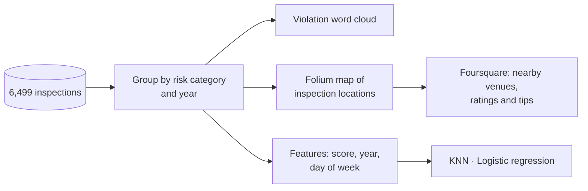
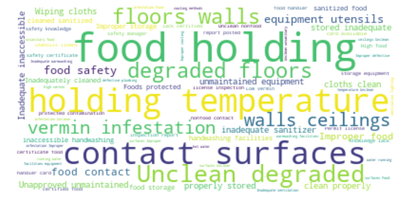

# San Francisco Food Inspection Risk

Capstone for the **IBM Data Science Professional Certificate** (Coursera, "Battle of the Neighborhoods"): explores San Francisco restaurant inspections, maps them, enriches them with Foursquare venue data, and tries to predict each inspection's risk category.

| | |
|---|---|
| **Category** | Data Science · Exploratory analysis · Classification · Geospatial |
| **Stack** | Python 3 · pandas · scikit-learn (KNN, logistic regression) · Folium · Foursquare Places API · WordCloud · BeautifulSoup · geopy |
| **Data** | 6,499 inspections of San Francisco food businesses, 2014–2016 ([DataSF restaurant scores](https://data.sfgov.org/)) · Foursquare venue data |
| **Status** | Completed 2020 |

## Why this project
Food inspections prevent food-borne illness, but inspectors have limited time. If the risk category of a visit could be predicted from data the city already holds, inspections could be prioritised toward the riskiest businesses. The full business problem and data plan are in [`report/`](report/).

## Approach


- **Exploration:** inspections by risk category per year, and the violation descriptions behind them.
- **Mapping:** the first 100 inspections plotted on a Folium map of San Francisco, coloured by risk.
- **Modelling:** risk mapped to 1 (low), 2 (moderate) and 3 (high); KNN with the best *k* chosen by accuracy, and logistic regression.
- **Enrichment:** the Foursquare API finds venues near an inspected business, with ratings and tips.
- A warm-up notebook clusters **Toronto neighbourhoods** from a scraped Wikipedia table of postal codes.

## Results
- **Class balance:** 3,468 low-risk, 2,245 moderate-risk and 786 high-risk inspections. More than half of businesses are low risk in every year.
- **Most common violations:** food holding temperature, unclean food-contact surfaces, degraded floors, walls and ceilings, and vermin.

  

- **Models:**

  | Model | Test accuracy | F1 (weighted) |
  |---|---|---|
  | KNN (k = 6) | 0.52 | 0.48 |
  | Logistic regression | 0.52 | 0.36 |
  | *Baseline: always predict "low risk"* | *about 0.53* | |

  **Honest reading:** neither model beats predicting the most common class. Inspection score, year and weekday don't carry enough information to predict risk. Violation types, business history and neighbourhood data would be the next features to try.

## What's in this folder
```
04-sf-food-inspection-risk/
├── notebooks/
│   ├── sf-food-inspection-risk.ipynb           the capstone: EDA, map, models, Foursquare
│   └── toronto-neighborhoods-clustering.ipynb  course assignment: scrape and cluster Toronto postal codes
├── report/
│   ├── business-problem.pdf · data-section.pdf · full-report.pdf
│   └── presentation.pptx
└── assets/violation-wordcloud.png
```

## How to run it
Python 3 with `pandas`, `scikit-learn`, `folium`, `geopy`, `wordcloud`, `requests` and `beautifulsoup4`. The Foursquare cells read credentials from environment variables:

```bash
export FOURSQUARE_CLIENT_ID=...      # from your Foursquare developer account
export FOURSQUARE_CLIENT_SECRET=...
```

The notebook uses the **Foursquare v2 API**, which has since been replaced by the Places API v3, so those cells need updating before they run again.

## Data, privacy & limitations
- **Credentials:** the original notebook had a Foursquare client ID and secret written into the code. They are removed here and read from the environment instead (and the old key should be revoked).
- **Personal data:** the original explored one reviewer's public Foursquare profile (name, home country, review history). That person is anonymised here and those outputs are cleared. Exploring an individual's profile doesn't serve the business question.
- The models only used three weak features and the first 100 inspections were mapped, both to save computing time.

## Next steps
1. Add violation types and each business's inspection history as features.
2. Compare with the majority-class baseline using balanced accuracy and recall on high-risk inspections.
3. Port the venue enrichment to the Foursquare Places API v3.

---
Part of [Data Science Projects](../../README.md) by **Trevor Kauyu**.
