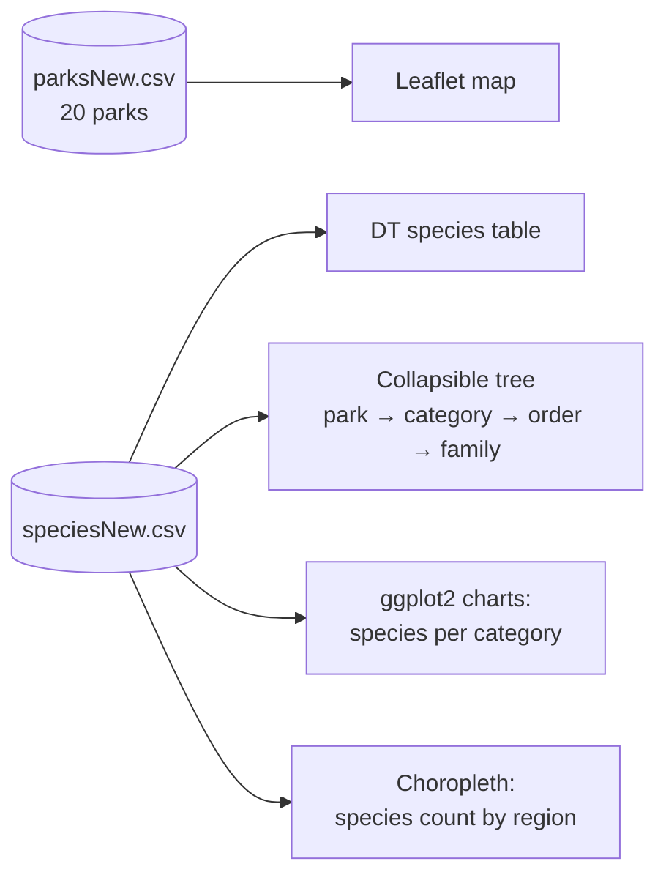

# ZimParks Biodiversity Dashboard

An R Shiny dashboard for exploring Zimbabwe's national parks: a map of the parks, a searchable species table, collapsible species trees, charts and a choropleth.

| | |
|---|---|
| **Category** | Data Science · Data Analytics & Dashboards · Geospatial |
| **Stack** | R · Shiny · shinydashboard · Leaflet (+ leaflet.extras) · DT · collapsibleTree · tidyverse / ggplot2 · tigris |
| **Data** | 20 Zimbabwean parks (11 national parks, 8 recreational parks, 1 botanical garden) with real coordinates · a **demo** species table (see limitations) |
| **Status** | Prototype, 2021. It was deployed on shinyapps.io; that deployment is no longer online |

## Why this project
Park managers, researchers and visitors need one place to see which parks hold which species and how biodiversity is spread across the country. The dashboard is a prototype of that interface for the Zimbabwe Parks and Wildlife Management Authority's parks.

## Approach


The app is adapted from **[bioNPS](https://github.com/abenedetti/bioNPS)** by abenedetti, a Shiny app for Kaggle's US National Parks biodiversity dataset. The park map, branding and park list were changed to Zimbabwe; the species analysis code is largely the original.

## Features
- **Map:** the 20 parks (Hwange, Gonarezhou, Mana Pools, Matobo, Victoria Falls, Lake Kariba and others) on a Leaflet map. Click a park to see its details.
- **Species table:** search and filter by park, category, order, family, occurrence, nativeness and abundance.
- **Species tree:** pick a park and a category to explore a collapsible hierarchy.
- **Charts and choropleth:** species counts per category for every park.

## What's in this folder
```
05-zimparks-biodiversity-dashboard/
└── app/
    ├── ui.R · server.R
    └── www/   parks and species CSVs, page text (Markdown), logos, stylesheet
```

## How to run it
In R (4.x):

```r
install.packages(c("shiny", "shinydashboard", "leaflet", "leaflet.extras", "DT",
                   "collapsibleTree", "shinycssloaders", "tidyverse", "tigris", "rvest"))
shiny::runApp("app")
```

## Data, privacy & limitations
- **The species data is a placeholder.** `speciesNew.csv` is the US National Park Service dataset with Zimbabwean park names swapped in, so it lists animals such as moose and white-tailed deer in Chimanimani. **It is not a record of Zimbabwe's wildlife.** Real data from ZimParks or GBIF would replace it.
- The **choropleth** still uses US state boundaries from `tigris`; it needs Zimbabwe's provinces instead.
- The map uses **Stamen Watercolor** tiles, which have moved to Stadia Maps and now need an API key; switch to `providers$OpenStreetMap` to run it without one.
- **Licence:** the original bioNPS repository has no licence. This adaptation is published for learning with credit to its author. Ask the author before reusing the code commercially.
- Removed before publishing: the original app's Google Analytics script (it reported to the original author's tracking ID), the shinyapps.io deployment file, and unrelated images.

## Next steps
1. Replace the species table with real records from [GBIF](https://www.gbif.org/) for Zimbabwe's protected areas.
2. Switch the choropleth to Zimbabwe's provinces and the map to keyless tiles.
3. Redeploy on shinyapps.io and add a screenshot.

---
Part of [Data Science Projects](../../README.md) by **Trevor Kauyu**.
