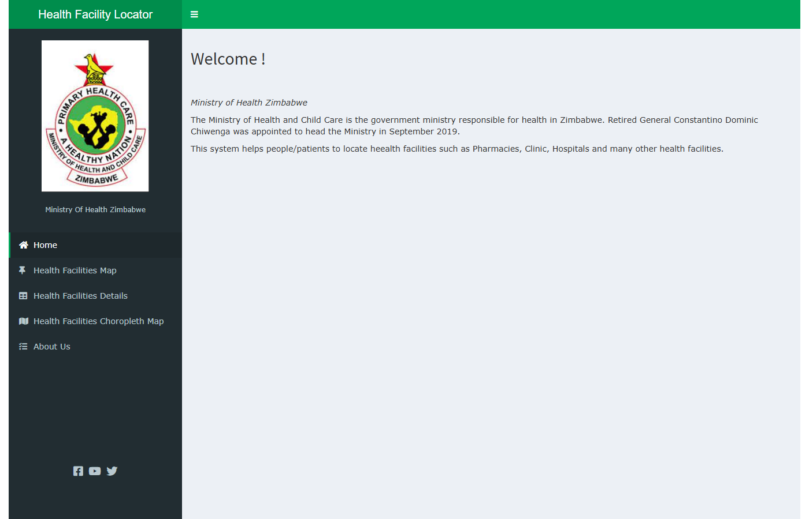

# Zimbabwe Health Facility Locator

A live R Shiny web app that helps people find health facilities in Zimbabwe (clinics, pharmacies, hospitals and others) on a map, in a searchable table and by region.

| | |
|---|---|
| **Category** | Data Science · Data Analytics & Dashboards · Geospatial |
| **Stack** | R · Shiny · shinydashboard · Leaflet · DT |
| **Live app** | **[trevork.shinyapps.io/HealthFacilityLocator](https://trevork.shinyapps.io/HealthFacilityLocator/)** |
| **Status** | Live on shinyapps.io (checked 2026-11) |



## Why this project
Patients, especially people new to an area, often don't know where the nearest clinic or pharmacy is, or which facility offers the service they need. A simple map of every facility, which can be searched and filtered, answers that question in seconds.

## Features
| Page | What it does |
|---|---|
| **Health Facilities Map** | Every facility as a marker on a Leaflet map; click one for its details |
| **Health Facilities Details** | A searchable, sortable table of the facilities |
| **Health Facilities Choropleth Map** | The number of facilities per region, to show where coverage is thin |
| **About Us** | Background on the app |

It is built on the same Shiny dashboard pattern as the [ZimParks Biodiversity Dashboard](../05-zimparks-biodiversity-dashboard/).

## What's in this folder
```
06-zim-health-facility-locator/
└── assets/app-home.png   screenshot of the live app
```

The app's source code has not been published yet; this page documents the live app.

## Data, privacy & limitations
- **This is an independent portfolio project, not an official Ministry of Health and Child Care system.** It uses the Ministry's name and logo to describe its subject; it does not speak for the Ministry.
- Facility lists change. Opening hours and services should be confirmed with the facility before travelling.
- The app holds facility locations only, no patient data.

## Next steps
1. Publish the app's source code in this folder.
2. Add "near me" search using the browser's location, and filters by service.
3. Refresh the facility list from an official or open source (for example Healthsites.io) and show the date of the last update.

---
Part of [Data Science Projects](../../README.md) by **Trevor Kauyu**.
