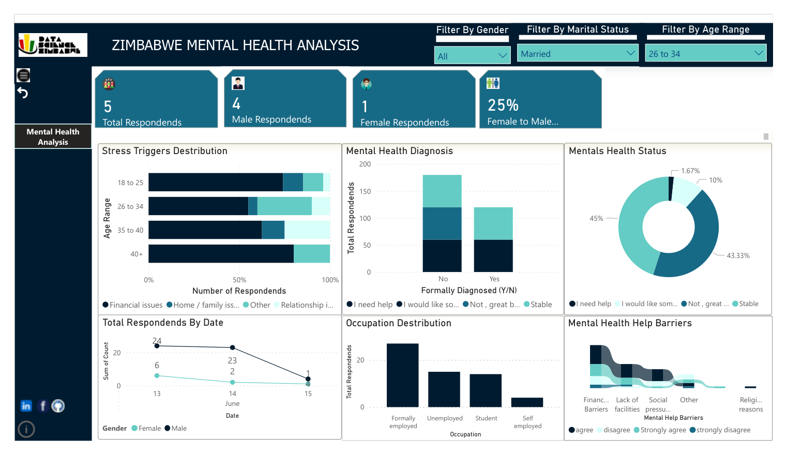

# Zimbabwe Mental Health Dashboard

An interactive Power BI dashboard of a Zimbabwean mental health survey: stress triggers, diagnosis, current mental health status and barriers to getting help, filterable by gender, marital status and age.

| | |
|---|---|
| **Category** | Data Science · Business Intelligence |
| **Stack** | Power BI Desktop · Power Query · DAX |
| **Data** | Zimbabwe Mental Health Analysis survey dataset from the Data Science Zimbabwe community |
| **Status** | Completed for a Data Science Zimbabwe community challenge |

## Why this project
Mental health services in Zimbabwe are stretched, and stigma stops many people from asking for help. A clear picture of *who* is struggling, *why*, and *what stops them getting help* lets NGOs and health planners target support. The dashboard turns the survey into that picture.



*The export above is filtered to married respondents aged 26 to 34, which is why the headline cards show 5 respondents.*

## What the dashboard shows
| Visual | Question it answers |
|---|---|
| Headline cards | How many respondents, by gender, and the female-to-male ratio |
| Stress triggers by age range | Which pressures (financial, home and family, relationships, other) dominate for each age group |
| Mental health diagnosis | How many respondents have been formally diagnosed, split by how they feel now |
| Mental health status | The share who say "I need help", "I would like some help", "not great but coping" or "stable" |
| Respondents by date | When responses came in, by gender |
| Occupation | Formally employed, unemployed, students and self-employed |
| Help barriers | How strongly respondents agree that cost, lack of facilities, social pressure or religious reasons stop them seeking help |

**Built with:** Power Query to clean and reshape the survey answers, DAX measures for the counts and ratios, and slicers for gender, marital status and age range that filter every visual.

## What's in this folder
```
07-zim-mental-health-dashboard/
├── dashboard/zim-mental-health-analysis.pdf   PDF export of the dashboard page
└── assets/dashboard.png                       image of the same page
```

The `.pbix` file is not included; the PDF shows the finished report.

## Data, privacy & limitations
- The dataset is a community survey shared by Data Science Zimbabwe. Only aggregated counts appear in the dashboard; no individual answers are published.
- It is a **small, self-selected** online sample, so the percentages describe the respondents, not Zimbabwe's population.
- Survey answers are self-reported and are not clinical diagnoses.

## Next steps
1. Publish the report to Power BI Service so it can be explored online.
2. Add confidence intervals or minimum-count warnings when filters leave very few respondents.

---
Part of [Data Science Projects](../../README.md) by **Trevor Kauyu**.
