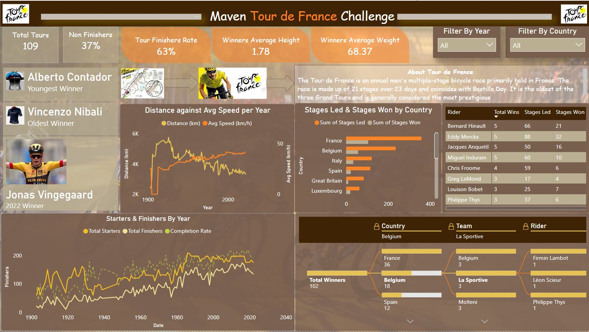

# Tour de France Dashboard

A Power BI dashboard built for the **Maven Analytics Tour de France Challenge**: 109 editions of the race, from winners' profiles to speeds, distances and how many riders finish.

| | |
|---|---|
| **Category** | Data Science · Business Intelligence |
| **Stack** | Power BI Desktop · Power Query · DAX |
| **Data** | Maven Analytics Tour de France dataset: every edition from 1903 to 2022, with stages, winners and finishers |
| **Status** | Completed for the Maven Analytics challenge |



## What the dashboard shows
- **Headline cards:** 109 Tours, a **63% finisher rate** (37% of starters don't finish), and winners' average height (1.78 m) and weight (68.4 kg).
- **Distance against average speed per year:** races got shorter after the 1920s, while average speed kept rising.
- **Stages led and won by country:** France, Belgium and Italy dominate.
- **Rider table:** total wins, stages led and stages won (Hinault, Merckx, Anquetil, Induráin, Froome, …).
- **Starters and finishers by year,** with the completion rate.
- **Decomposition tree:** winners by country, team and rider.
- Slicers for year and country.

**Built with:** Power Query to clean and join the stage, rider and winner tables; DAX for the rates, averages and rankings; a decomposition tree and custom card layout.

## Review notes
Checking a dashboard's numbers against known facts is part of the job. Two cards need fixing:
- **"Youngest winner" shows Alberto Contador,** but the youngest Tour winner is Henri Cornet (1904, aged 19).
- **"Oldest winner" shows Vincenzo Nibali** (who won in 2014, aged 29), but the oldest winner is Firmin Lambot (1922, aged 36).

The likely cause is that the age measure only covers winners with a birth date in the dataset, or uses the wrong date column. The fix is to calculate age at the race date for every winner and to show a warning when birth dates are missing.

## What's in this folder
```
08-tour-de-france-dashboard/
└── assets/dashboard.jpg   image of the dashboard
```

The `.pbix` file is not included.

## What I learned
Power Query for cleaning and shaping data, DAX for measures and calculated columns, and designing visuals that tell the story of the race at a glance.

## Next steps
1. Fix the youngest and oldest winner measures as described above.
2. Publish to Power BI Service and add the `.pbix` file.

---
Part of [Data Science Projects](../../README.md) by **Trevor Kauyu**.
