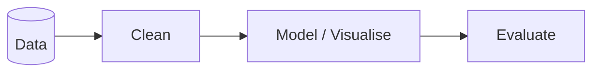

# <Project name>

<One-sentence description of what it does and for whom.>

| | |
|---|---|
| **Category** | Data Science · <Machine Learning / NLP / Computer Vision / BI Dashboard> |
| **Stack** | <tools and versions> |
| **Data** | <source, size, period, licence> |
| **Status** | <Completed DATE / Prototype / Live at URL> |

## Why this project
<The question, who needs the answer, and what decision it supports.>

## Approach

<Key cleaning decisions and why. Methods tried.>

## Results
<Real numbers from the notebook, with a baseline for comparison. One chart from assets/.>

## What's in this folder
```
NN-project-name/
├── notebooks/
├── data/
└── assets/
```

## How to run it
### Prerequisites
### Steps

## Data, privacy & limitations
<Sources and licences. What was masked before publishing. What the results can't support.>

## Next steps

---
Part of [Data Science Projects](../../README.md) by **Trevor Kauyu**.
